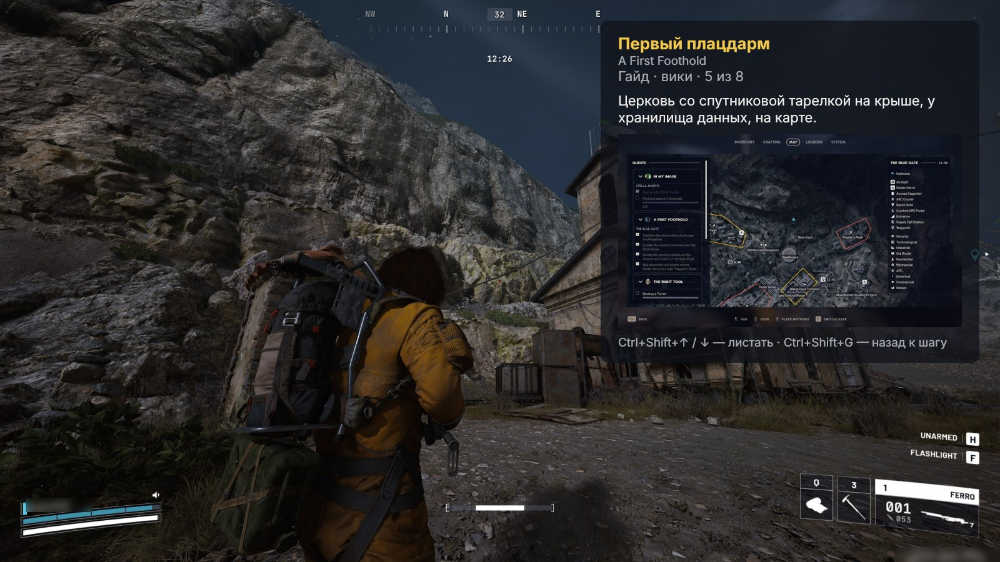
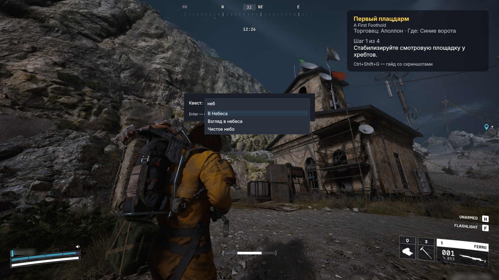

# ARC Raiders — подсказчик квестов

Программа для Windows, которая показывает поверх игры ARC Raiders полупрозрачную карточку
с текущим шагом квеста и гайдом по его прохождению со скриншотами.

Квест вводится вручную по названию — программа не читает память игры и никак в неё не вмешивается.



## Возможности

- **Все квесты игры** с официальными русскими названиями и целями.
- **Гайд со скриншотами** по каждому квесту: куда идти и что делать на каждом шаге.
- **Карта с точками**: `Ctrl+Shift+K` показывает карту локации с отмеченными местами квеста,
  цифра у точки — номер шага, точка текущего шага выделена.
- **Трекер прохождения**: несколько активных квестов с переключением одной клавишей,
  прогресс сохраняется между запусками, после выполнения квеста следующие по цепочке
  добавляются сами.
- **Импорт с экрана**: откройте в игре список квестов (например, в лобби) и нажмите
  `Ctrl+Shift+I` — программа распознает их на снимке экрана и добавит в список. С игрой
  программа при этом не взаимодействует: это обычный скриншот и встроенное распознавание
  текста Windows.
- **Быстрый поиск**: список подсказок появляется прямо при вводе, опечатки и английские
  названия тоже понимаются.
- **Не мешает игре**: клики проходят сквозь карточку, всё управление — горячими клавишами,
  а когда вы переключаетесь из игры в другое окно, карточка прячется сама.
- **Брать или продавать?** Наведите курсор на предмет в игре и нажмите `Ctrl+Shift+E`:
  программа распознает название в подсказке и скажет, нужен ли предмет для ваших квестов
  и мастерских, на что он разбирается и сколько стоит.
- **Поиск предметов**: `Ctrl+Shift+P`, введите название (например, «Водяной насос») — программа
  покажет, в каких местах с лутом он лежит, на каких картах таких мест больше всего, из каких
  машин выпадает и разборкой чего получается, из чего крафтится и у какого торговца купить.
  `Ctrl+Shift+K` отметит эти места на карте.
- **Учёт чертежей**: отметьте изученные чертежи (меню значка в трее → «Чертежи…» или
  `Ctrl+Shift+B` в карточке предмета) — проверка предмета скажет, забрать найденный чертёж
  или его можно продать.
- **Что собрать**: общий список предметов для всех активных квестов и следующих уровней
  мастерских — удобно перед рейдом. Уровни мастерских отмечаются в меню значка в трее.
- **Настраиваемый вид**: карточку можно перетащить в любое место экрана, поменять её масштаб
  и прозрачность фона.
- **Обновляется сама**: новые квесты и гайды подтягиваются автоматически раз в сутки.
- **Без установки**: распаковал и запустил, всё хранится в одной папке.

## Установка

Нужна **Windows 10 или 11 (64-бит)**. Ничего дополнительно устанавливать не нужно — всё,
что требуется программе, уже в архиве. Интернет нужен для гайдов из Steam и обновлений;
без него работают встроенная база квестов и гайды с вики.

1. Скачайте [**ARC-Raiders-Overlay.zip**](https://github.com/r4v3r-63/arc-raiders-overlay/releases/latest/download/ARC-Raiders-Overlay.zip)
   и распакуйте в любую папку.
2. Запустите `ARC-Raiders-Overlay.exe`. Если Windows покажет «Система Windows защитила ваш
   компьютер», нажмите «Подробнее» → «Выполнить в любом случае».
3. В настройках игры выберите режим экрана **«Оконный без рамки»** — в полноэкранном режиме
   Windows не показывает окна поверх игры.

При первом запуске откроется короткий обзор возможностей. В правом верхнем углу экрана
появится карточка, а в трее рядом с часами — жёлтый значок «?». Через меню этого значка можно
включить запуск вместе с Windows, снова открыть обзор («Как пользоваться») и посмотреть, что
появилось в последних обновлениях («Что нового» — после обновления это окно откроется само).

Когда выйдет новая версия программы, она сообщит об этом сама. Чтобы обновиться, скачайте
архив заново и распакуйте поверх старой папки.
Чтобы удалить — удалите папку (если включали запуск вместе с Windows, сначала снимите эту галочку).

## Как пользоваться



| Клавиши | Действие |
|---|---|
| `Ctrl+Shift+Q` | ввести квест (он добавится в список активных) |
| `Ctrl+Shift+→` / `←` | следующий / предыдущий шаг квеста |
| `Ctrl+Shift+Tab` | переключить активный квест |
| `Ctrl+Shift+D` | квест выполнен — следующие по цепочке добавятся сами |
| `Ctrl+Shift+I` | найти квесты на экране игры и добавить в список |
| `Ctrl+Shift+L` | что собрать для всех активных квестов |
| `Ctrl+Shift+E` | брать или продавать: проверить предмет под курсором |
| `Ctrl+Shift+P` | найти предмет по названию: где искать и нужен ли он |
| `Ctrl+Shift+B` | отметить чертёж из карточки предмета изученным / не изученным |
| `Ctrl+Shift+G` | гайд со скриншотами / назад к шагу |
| `Ctrl+Shift+↑` / `↓` | листать страницы гайда |
| `Ctrl+Shift+F` | скриншот гайда на весь экран |
| `Ctrl+Shift+K` | карта с точками текущего квеста или мест, где искать предмет (`Ctrl+Shift+↑` / `↓` — другая карта) |
| `Ctrl+Shift+O` | открыть гайд квеста в браузере |
| `Ctrl+Shift+X` | спрятать / показать карточку |
| `Ctrl+Shift+M` | настройка: перетащить мышкой, колёсико — масштаб, Ctrl + колёсико — прозрачность |
| `Ctrl+Shift+H` | справка со всеми сочетаниями клавиш |

Список активных квестов есть и в меню значка в трее: там можно переключиться на любой квест
или убрать квест, взятый по ошибке.

Любое сочетание можно поменять: меню значка в трее → «Горячие клавиши…».

Справка также открывается кнопкой «?» в окне ввода и в меню значка в трее. Там же —
ссылки на гайд в Steam, видео на YouTube и страницу квеста на вики, очистка кэша и выход
из программы.

## Где хранятся данные

```
ARC-Raiders-Overlay\
├── ARC-Raiders-Overlay.exe
├── _internal\          программа и встроенная база квестов
└── Данные\             скачанные гайды, настройки и прогресс: квесты, уровни мастерских,
                        изученные чертежи (появляется при первом запуске)
```

Если что-то пошло не так, программа записывает подробности в `Данные\ошибки.log`.

## Нашли ошибку?

[Напишите о проблеме](https://github.com/r4v3r-63/arc-raiders-overlay/issues/new/choose) — опишите,
что случилось, и приложите скриншот (и файл `Данные\ошибки.log`, если он есть).

## Источники

- Квесты, предметы, враги и мастерские — [RaidTheory/arcraiders-data](https://github.com/RaidTheory/arcraiders-data)
  и [arctracker.io](https://arctracker.io) (MIT).
- Гайды и скриншоты — [arcraiders.wiki](https://arcraiders.wiki/wiki/Quests) (CC BY-SA 4.0)
  и [«[RU] Руководство по квестам Arc Raiders»](https://steamcommunity.com/sharedfiles/filedetails/?id=3672641520)
  в Steam от El1teHarp521. Руководство Steam не хранится в репозитории: программа загружает его
  на компьютере пользователя.
- Карты, места на них и типы лута в этих местах — [Speranza Field Guide](https://github.com/tyler45455/Arc-Raiders-hub)
  (данные arcraiders.wiki, CC BY-SA 4.0).

- Фон на картинках в этом README — игровой скриншот с arcraiders.wiki (CC BY-SA 4.0),
  окна программы наложены поверх него.

ARC Raiders и все игровые материалы © Embark Studios AB. Программа не связана с Embark Studios.

## Лицензия

Код программы — [MIT](LICENSE). Данные сторонних источников сохраняют свои лицензии:
данные квестов из arcraiders-data — MIT; тексты гайдов с вики, их перевод
(`tools/translations/ru.json`) и скриншоты в `arc_overlay/data/guides` и карты в `arc_overlay/data/maps` — CC BY-SA 4.0;
названия и материалы игры — © Embark Studios AB.
